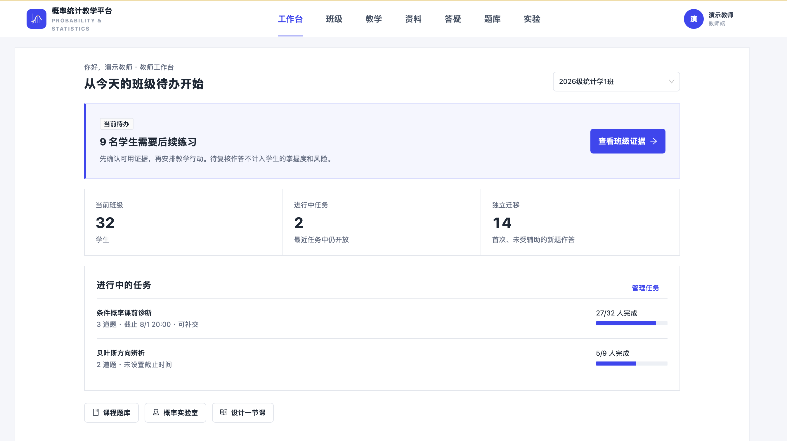
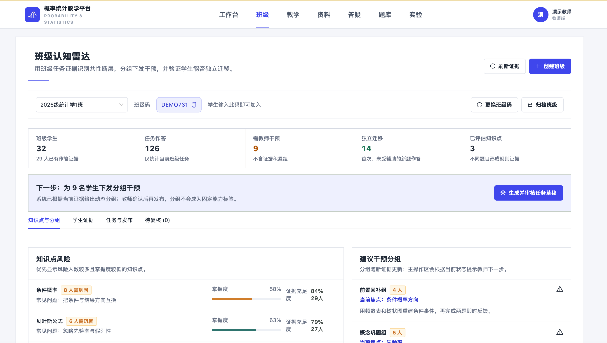
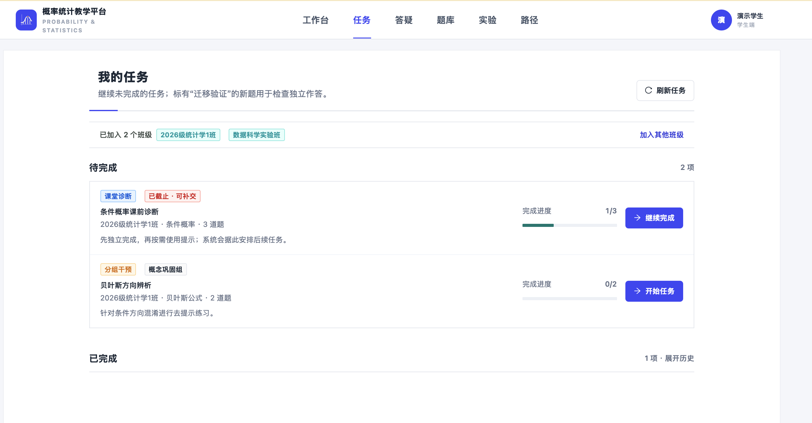
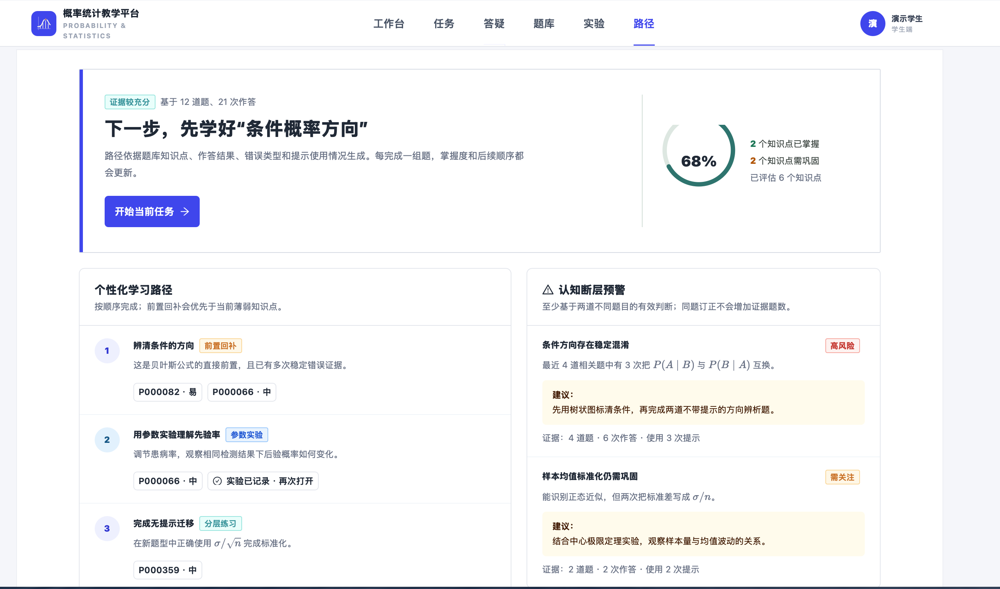
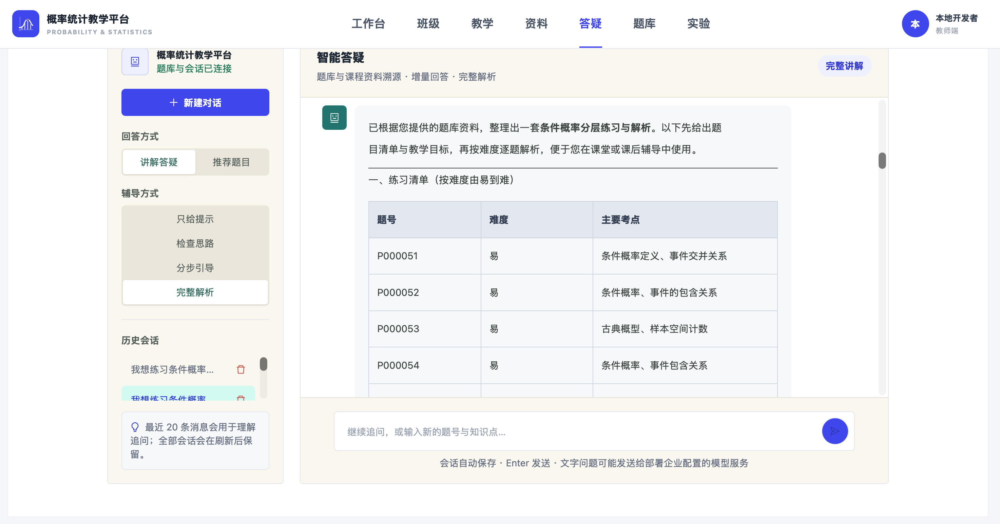
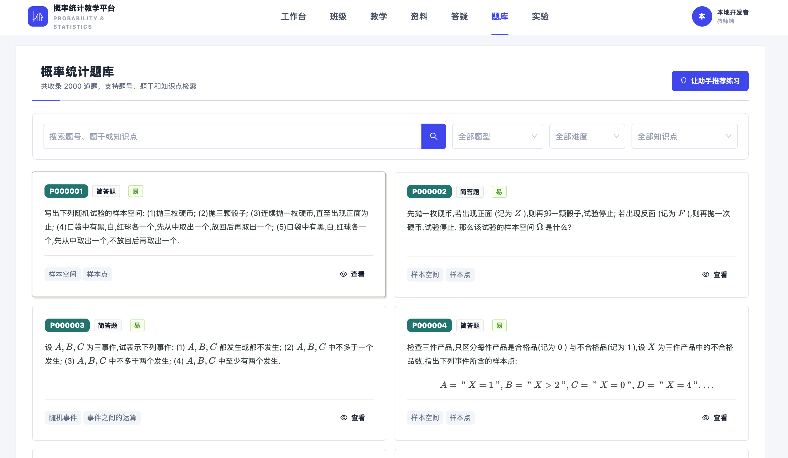

# 概率统计教学平台

面向大学概率论与数理统计课程的题库问答与教学助手。系统由 React、FastAPI 和 SQLAlchemy 构建，开发环境可使用 SQLite，正式部署使用 PostgreSQL。

[在线演示](https://0731shayne.github.io/PSA/) · [部署说明](#公司接手需要准备什么)

## 界面预览

点击截图可查看大图。

| 教师工作台 | 班级认知雷达 |
| --- | --- |
| [](docs/screenshots/teacher-dashboard.png) | [](docs/screenshots/classroom-radar.png) |

| 学生任务 | 个性化学习路径 |
| --- | --- |
| [](docs/screenshots/student-tasks.png) | [](docs/screenshots/learning-path.png) |

| 智能答疑 | 概率统计题库 |
| --- | --- |
| [](docs/screenshots/ai-tutor.png) | [](docs/screenshots/question-bank.png) |

## 当前能力

- 学生端：四种辅导方式、流式答疑、多方式作答诊断、知识点掌握度、认知断层预警和个性化学习路径
- 题目推荐由配置的 DeepSeek 模型识别练习需求，然后按知识点、难度和题型从题库筛选。模型不可用时使用本地规则检索。
- 讲解答疑优先使用题库及有权检索的课程资料。找不到匹配资料时，由配置的 DeepSeek 进行通用讲解并标明来源。模型不可用时，页面会显示已有资料或说明暂时无法回答。
- 手写识别：JPG、PNG、WebP 作答图片通过 MinerU Cloud OCR 提取文字与 LaTeX 公式，识别结果和原图一并留存并参与诊断
- 教学闭环：教师创建班级并发布短诊断，学生使用班级码加入和完成任务；系统按班级证据生成知识点风险、动态干预分组和无提示迁移验证
- 探究实验：提供大数定律、概率分布、极限定理、贝叶斯、置信区间与蒙特卡洛等 8 个参数化实验，并关联题库练习
- 教师端：按主题、课时、课堂类型、学情基线和指定题号生成教师执行版、无答案学生学习单与证据报告，可编辑、保存、分别导出，并把任一层级直接发布为班级任务
- 身份登录：账号分为 `student` 和 `teacher`，教师注册需要部署方配置的邀请码；浏览器会话使用 HttpOnly Cookie
- 专属题库：内置 `P000001`—`P002000` 共 2000 道题，含 54 张配图。
- 可替换 RAG 课程资料库：本地作品模式由 Ollama `bge-m3` 生成真实 Embedding、SQLite 保存向量并计算余弦相似度；企业模式切换到 RAGFlow。资料可绑定班级，回答会展示题目与文件片段两类依据
- 会话记忆：自动保存历史会话，并携带最近 20 条消息支持连续追问

学习路径依据题库 `keypoint_ids`、作答正确性、错误类型、提示次数和重复尝试动态计算。预警至少需要两次相关作答证据；证据较少时会明确标记低可信度，不把一次失误直接判断为知识断层。

班级认知雷达只统计当前教师所建班级内的任务作答，不读取其他班级或学生个人自学会话。系统会把学生暂时分为证据积累、前置回补、去提示练习、概念巩固和迁移挑战等任务组；分组随新证据更新，用于安排下一项任务，不作为固定能力标签。

分层教学包由可审计的课程规则引擎生成，不依赖模型 API Key。引擎会保证课堂时间闭合、题目可追溯、教师答案与学生版本分离，并为每层写明适用证据、达标标准和升级条件；关联班级时，仅使用该班级与所选题目直接相关的任务作答。

## 公司接手需要准备什么

GitHub 源码包包含前后端、数据库迁移、部署模板、2000 道题、54 张配图和 4 份公共课程资料。公司解压后按下表配置自己的运行环境。真实密钥统一放在公司服务器的 `backend/.env` 或容器密钥配置中。老师自行上传的资料、账号和班级记录来自各自部署的数据库，已有业务数据单独备份交付。

| 需要使用的功能 | 公司需要准备 | 当前本地开发环境 |
| --- | --- | --- |
| 登录、内置题库、班级任务、教学包和实验 | 正式运行使用 PostgreSQL 17、随机 `SECRET_KEY` 和一个初始教师账号。Docker Compose 会启动数据库 | 前后端在本机运行，SQLite 保存数据，开发教师入口已启用 |
| 真实 AI 讲解、无资料时的通用讲解、推荐意图识别和开放题诊断 | 公司自己的 `DEEPSEEK_API_KEY`，以及访问配置的 DeepSeek API 的网络。默认模型为 `deepseek-v4-pro` | 已配真实 DeepSeek，`DEEPSEEK_MOCK=false` |
| 手写作答的自动文字和公式识别 | 可选。公司的 `MINERU_TOKEN` 和访问 MinerU 的网络。留空时仍可保存图片，由教师复核 | 已配置 MinerU Token |
| 教师上传资料并在问答中检索 | 可选。小规模可选 `local` 并运行 Ollama 与 `bge-m3`。也可选 `ragflow`，由公司提供 RAGFlow 地址、API Key 和可用的向量模型 | 采用 `local`，本机 Ollama 运行 `bge-m3` |

**RAGFlow 和 Ollama 都可以按需启用。** 只需内置题库、班级功能和 DeepSeek 答疑时，保留 `KNOWLEDGE_BACKEND=disabled` 即可。开启课程资料功能时，从 `local` 和 `ragflow` 选一个。当前本地使用 Ollama，RAGFlow 已接入代码，可在公司具备该服务后启用。GitHub Pages 供演示，企业业务使用部署后的应用。

## 环境要求

- Docker 部署使用 Docker Engine 与 Compose v2，镜像内提供 Python 3.12、Node.js 22 和 PostgreSQL 17。
- 从源代码直接运行时自行安装 Python 3.12 和 Node.js 22。本地开发默认使用 SQLite。

## 本地开发（SQLite）

在 macOS 或 Linux 启动后端：

```bash
cd backend
python -m venv .venv
source .venv/bin/activate
python -m pip install -r requirements.txt
test -f .env || cp .env.example .env
```

首次本地体验，在 `backend/.env` 设置 `APP_HOST=127.0.0.1` 与 `DEV_LOGIN_ENABLED=true`。需要真实答疑时再填入自己的 `DEEPSEEK_API_KEY`。保留模板的 `KNOWLEDGE_BACKEND=disabled` 可先验证基础功能。

在同一个后端终端启动服务：

```bash
python run.py
```

前端另开一个终端：

```bash
cd web
npm ci
npm run dev
```

浏览器访问 `http://localhost:5173`，可点击「一键进入本地教师端」。SQLite 数据默认写入 `backend/teaching_assistant.db`。

如果要启用教师资料检索，在 `backend/.env` 改为 `KNOWLEDGE_BACKEND=local`，然后安装并运行 Ollama 与 Embedding 模型：

```bash
brew install ollama
brew services start ollama
ollama pull bge-m3
```

`brew services start ollama` 会让 Ollama 在后台运行并随登录启动。如果只想临时前台运行，可以先停止后台服务，再执行 `ollama serve`。

本地算法、Mac 运行和面试讲解见 [本地简化 RAG 演示指南](docs/LOCAL_RAG_DEMO.md)；企业部署与替换边界见 [RAGFlow 课程资料库接入指南](docs/RAGFLOW_KNOWLEDGE_BASE.md)。将 `KNOWLEDGE_BACKEND=disabled` 时，内置题库、班级、教学包和原有智能答疑仍可正常运行。

## GitHub Pages 静态预览

仓库包含 `.github/workflows/pages.yml`，可将 React 前端部署到 GitHub Pages。Pages 构建会启用浏览器内模拟 API，访客无需账号即可分别进入教师端和学生端，浏览题库、任务、学习路径、班级雷达、教学包和预设答疑效果。演示操作仅保存在访客自己的浏览器中，不会写入真实数据库或调用模型服务；真实登录、多人共享数据和 AI 答疑仍需部署后端。

## PostgreSQL / Docker 部署

这套方式会构建前端、运行 Alembic 数据库迁移并启动 PostgreSQL 与后端。企业的真实服务器、域名和密钥不应写入源代码。

1. 安装 Docker Engine 与 Compose v2，桌面验收也可用 Docker Desktop。构建环境需能下载容器镜像及 Python、npm 依赖。
2. 创建配置文件：

```bash
cd backend
test -f .env || cp .env.example .env
```

3. 至少修改以下配置：

```ini
SECRET_KEY=至少32个字符的随机密钥
POSTGRES_PASSWORD=数据库强密码
BOOTSTRAP_TEACHER_USERNAME=admin
BOOTSTRAP_TEACHER_PASSWORD=至少12位的初始教师密码
DEV_LOGIN_ENABLED=false
ALLOWED_ORIGINS=
KNOWLEDGE_BACKEND=disabled
```

公司需要真实模型能力时填入自己的 `DEEPSEEK_API_KEY`，保留 `DEEPSEEK_MOCK=false`。需要自动手写识别时另填 `MINERU_TOKEN`。需要检索教师资料时选定资料后端并配置其地址。应用在容器内运行时，资料后端的地址须从容器可访问。本机起的 Ollama 或 RAGFlow 可在 Docker Desktop 上使用 `host.docker.internal`，Linux 可填写同一容器网络中的服务名或公司私网地址。

4. 构建并启动：

```bash
docker compose up --build -d
docker compose ps
curl --fail http://localhost:8101/health/ready
```

在本机访问 `http://localhost:8101` 验证启动。企业环境通过同域 HTTPS 入口访问，登录 Cookie 使用 `Secure`。Docker 配置中的数据库密码填原值，含美元符号时用单引号包住整个值。直接连接外部 PostgreSQL 时，按下方示例为数据库连接地址中的密码做 URL 编码。

首次启动会执行 `alembic upgrade head`，并在配置了初始教师账号时创建该账号。该账号首次登录会被强制修改初始密码，改密后其他旧会话立即失效。重复启动会复用已有账号。

用教师账号登录后，打开「题库」搜索 `P002000`，验证内置题库。已配置 DeepSeek 时，在「答疑」提问并检查回答来源是否显示模型名称。启用了教师资料功能时，用示例讲义验证上传、解析、班级绑定和学生问答引用。数据库就绪检查仅确认主系统能连接数据库。

查看日志或停止服务：

```bash
docker compose logs -f app
docker compose down
```

`docker compose down` 不会删除 PostgreSQL 数据卷。只有明确执行 `docker compose down -v` 才会删除数据库数据。

## 正式环境配置

配置模板位于 `backend/.env.example`，正式配置复制为 `backend/.env`，不要提交到 Git。

| 变量 | 用途 |
|---|---|
| `APP_ENV` | 本地为 `development`；Docker 会覆盖为 `production` |
| `DATABASE_URL` | 直接运行后端时的数据库地址 |
| `SECRET_KEY` | JWT 签名密钥，生产环境至少 32 个字符 |
| `ALLOWED_ORIGINS` | 逗号分隔的前端来源；同域部署可留空 |
| `POSTGRES_DB` | Docker PostgreSQL 数据库名 |
| `POSTGRES_USER` | Docker PostgreSQL 用户名 |
| `POSTGRES_PASSWORD` | Docker PostgreSQL 密码；用于连接地址时特殊字符需 URL 编码 |
| `BOOTSTRAP_TEACHER_*` | 可选的首个教师账号，只在账号不存在时创建 |
| `TEACHER_REGISTRATION_CODE` | 可选；教师自行注册时必须提供的邀请代码 |
| `DEEPSEEK_API_KEY` | 真实 AI 功能所需的公司密钥。留空时内置题库和规则推荐可用 |
| `DEEPSEEK_BASE_URL` / `DEEPSEEK_MODEL` | 生成模型的地址和名称，模板默认指向 DeepSeek |
| `DEEPSEEK_MOCK` | 离线测试开关，真实部署设为 `false` |
| `DEEPSEEK_TIMEOUT_SECONDS` | 模型请求超时秒数，默认 60 |
| `DEEPSEEK_MAX_RETRIES` | 模型请求最大重试次数，默认 2、最大 5 |
| `MINERU_TOKEN` | MinerU Cloud OCR Token；未配置时图片仍保存，但不会自动识别 |
| `MINERU_BASE_URL` | MinerU v4 API 地址，默认 `https://mineru.net/api/v4` |
| `MINERU_MODEL` | 图片解析模型，默认 `vlm`，也可配置 `pipeline` |
| `MINERU_TIMEOUT_SECONDS` | 单张图片识别等待上限，默认 120 秒 |
| `MINERU_USE_ENV_PROXY` | 是否读取系统代理变量，默认 `false` |
| `KNOWLEDGE_BACKEND` | 可选资料检索。默认 `disabled`。`local` 对接 Ollama，`ragflow` 对接公司的 RAGFlow |
| `LOCAL_EMBEDDING_BASE_URL` | Ollama 地址，本机默认 `http://localhost:11434` |
| `LOCAL_EMBEDDING_MODEL` | 本地真实 Embedding 模型，默认 `bge-m3` |
| `LOCAL_CHUNK_SIZE` / `LOCAL_CHUNK_OVERLAP` | 本地文本块大小与重叠字符数，默认 900/120 |
| `RAGFLOW_BASE_URL` | RAGFlow 服务地址；应用在 Docker 内、RAGFlow 在宿主机时通常为 `http://host.docker.internal:9380` |
| `RAGFLOW_API_KEY` | RAGFlow HTTP API Key，只保存在后端环境变量中 |
| `RAGFLOW_EMBEDDING_MODEL` | 可选；RAGFlow 中已配置的模型标识，例如 `bge-m3@Ollama`；留空使用其默认模型 |
| `RAGFLOW_RERANK_ID` | 可选的 Rerank 模型标识；第一版可留空 |
| `RAGFLOW_CHUNK_METHOD` | 文档切分策略，课程讲义默认 `book` |
| `RAGFLOW_*THRESHOLD` / `*_WEIGHT` / `TOP_K` | 召回阈值、向量权重和候选上限，先使用模板默认值并用真实问题评测后调整 |

不使用 Docker、直接连接企业 PostgreSQL 时设置：

```ini
APP_ENV=production
DATABASE_URL=postgresql+asyncpg://用户名:URL编码后的密码@数据库地址:5432/数据库名
SECRET_KEY=至少32个字符的随机密钥
ALLOWED_ORIGINS=https://实际前端域名
```

生产模式会拒绝默认密钥、非 PostgreSQL 数据库及通配符 CORS 配置。若前后端由同一个域名提供，浏览器请求属于同源访问，`ALLOWED_ORIGINS` 可以留空。

## 数据库迁移与升级

数据库结构由 Alembic 管理。修改 ORM 模型后，应创建并检查迁移：

```bash
cd backend
alembic revision --autogenerate -m "describe change"
alembic upgrade head
alembic check
```

企业升级源代码后，在启动新版本应用前执行：

```bash
alembic upgrade head
```

Docker 镜像的入口脚本会自动执行这一步。SQLite 与 PostgreSQL 是两套独立数据库，已有 SQLite 数据不会因为修改连接地址自动复制到 PostgreSQL；如需保留历史数据，应在正式切换前单独制定数据迁移和核对方案。

## 备份与恢复

Docker 环境备份示例：

```bash
docker compose exec -T db pg_dump -U mra -d mra -Fc > mra.backup
```

恢复前应停止应用写入，并由部署人员确认目标数据库：

```bash
docker compose exec -T db pg_restore -U mra -d mra --clean --if-exists < mra.backup
```

实际生产环境的备份频率、保存位置、加密和恢复演练由部署方按照企业制度执行。

## 题库数据

默认题库为 `backend/data/probability_questions.jsonl`。每行是一道题：

```json
{"ID":"P000001","qtype":"简答题","question":"...","keypoint":["样本空间"],"answer":"...","explanation":"...","hard_level":"易"}
```

克隆仓库或在 GitHub 下载 ZIP 即可取得完整题库。配图保存在 [backend/data/images](backend/data/images)，每题的 `images` 字段列出对应文件名，多图按列表顺序排列。题干或解析中的 Markdown 图片路径相对于题库文件。正式平台和 GitHub Pages 演示共用这份题库，无需导入数据库。

## 课程资料交付

随源码交付的公共资料位于 [backend/data/course_materials](backend/data/course_materials)。将可公开分发的课程大纲、教材节选、公式说明或课堂例题放入 `files/`，并按 [目录清单](backend/data/course_materials/catalog.json) 中的格式登记文件名、标题、简介和类型。类型 `concept` 用于讲义，`example` 用于例题。此目录中的文件将随源码和前端发布。内置 Markdown 资料支持在线阅读，其他格式可下载。

教师在“课程资料库”创建自己的库，然后选择“加入当前库”或“上传文件”。文件显示“可检索”后，绑定班级并允许学生引用，该班学生的答疑即可检索相关片段。完整解答可作为单独文件上传，类型选“完整解答”。提示和分步模式会排除完整解答。

教师上传的原件保存在该部署的 PSA 数据库，本地默认是 `backend/teaching_assistant.db`，Docker 部署使用 PostgreSQL 数据卷。资料归上传教师管理，可从“课程文件”下载原件。启用 RAGFlow 时文件也会发送至配置的 RAGFlow 服务进行解析。交付已有班级的运行数据时，另行备份 PSA 数据库，并按需备份 RAGFlow 数据。旧版已上传的资料仍可按原有方式检索，平台留存原件从此次版本开始。

## 验证

```bash
cd web && npm ci && npm run test:math && npm run test:ui && npm run build
cd ../backend && pytest -q
```

真实页面的手机与桌面验收：

```bash
cd web
npx playwright install chromium
npm run test:e2e
npm run test:demo
```

数学内容统一经过 `MathMarkdown` 渲染：兼容 `$...$`、`$$...$$`、`\\(...\\)`、`\\[...\\]` 和题库中的二次转义分隔符，同时保护代码块与矩阵换行。无需使用文档 OCR API 处理已有 LaTeX。

CI 会分别在全新 SQLite 和真实 PostgreSQL 数据库上执行 `alembic upgrade head`、`alembic check` 和后端测试，并执行前端生产构建、手机/桌面浏览器验收及 Docker Compose 生产栈健康检查。本地已有的旧 SQLite 文件可能没有 Alembic 版本标记，不应在未备份、未核对结构前直接执行 `alembic stamp`。

服务提供两个健康检查接口：

- `/health/live`：应用进程存活
- `/health/ready`：应用可以连接数据库
- `/api/knowledge/health`：教师登录后检查 Ollama/bge-m3 或 RAGFlow；知识库后端异常不会改变主应用的就绪状态

## 团队协作

建议每项改动使用独立分支并通过 Pull Request 合并；提交前运行与改动范围对应的测试，并确保配置文件、密钥和本地数据库未被纳入版本控制。

## 源代码交付边界

本仓库交付应用源代码、依赖清单、数据库迁移、容器配置、配置模板和部署说明，不包含公网服务器。部署方负责提供实际服务器、域名、HTTPS 证书、数据库密码、`SECRET_KEY`、模型 API Key、网络入口限流/WAF、网络策略以及日常备份与监控。

学生提交的文字答案、解题思路与答疑文字可能发送给部署方配置的模型服务；配置 `MINERU_TOKEN` 后，上传的手写图片会发送至 MinerU Cloud OCR 识别文字和公式，识别结果随后进入诊断模型。教师上传的课程原件保存在 PSA 数据库。`local` 模式另存提取文本、切片和向量。`ragflow` 模式将文件发送到所配置的 RAGFlow 建立索引。系统界面会明确标识这些数据边界。任务撤回、归档或成员移出会保留既有作答与提示审计；学生可删除自己的答疑会话和实验记录，教师可删除自己的教学包。企业部署前应按自身制度确认模型供应商、隐私告知、备份与数据库数据的保存周期、导出和彻底删除流程。

交付前不得把 `.env`、数据库文件、真实密码、真实 API Key 或企业内部地址提交到仓库。

交付评审可同时参考 [系统架构与数据边界](docs/ARCHITECTURE.md)、[企业交付验收清单](docs/ACCEPTANCE.md)、[安全说明](SECURITY.md) 和 [变更记录](CHANGELOG.md)。本项目不要求开发者个人先购买公网服务器；企业在其基础设施上完成部署、安全评审和最终生产验收即可。
